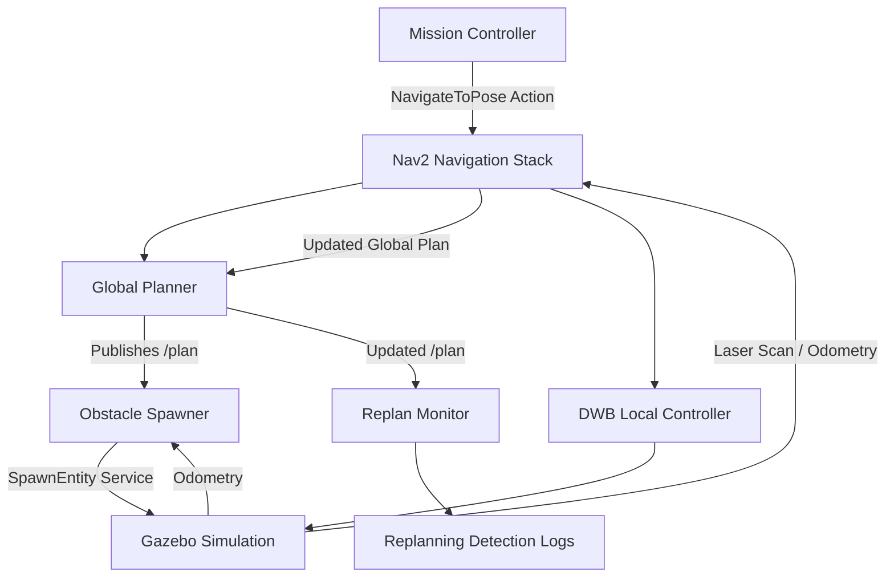

# Autonomous Warehouse Robot with Dynamic Path Replanning

A simulated autonomous warehouse robot built using **ROS 2 Humble, Nav2, and Gazebo Classic 11**. The robot navigates between user-defined waypoints and dynamically replans its route when unexpected obstacles appear during navigation, allowing it to continue its mission without requiring manual intervention.

The project demonstrates autonomous navigation, dynamic obstacle spawning, real-time global path replanning, and coordination between multiple ROS 2 nodes.

---

## Demo

**Watch the warehouse robot navigate autonomously and dynamically replan its path when new obstacles appear.**

[▶ Watch the Warehouse Robot Demo](media/warehouse.mp4)

> The demo video is available in the `media/warehouse.mp4` repository folder. For an inline GitHub video player, replace this link with a GitHub video attachment URL after uploading the video through the README editor.

---

## The Problem

In real warehouse environments, autonomous mobile robots must navigate through dynamic and unpredictable surroundings.

Unexpected obstacles such as workers, misplaced boxes, or other robots can block a previously planned route.

Basic navigation systems may stop, wait, or fail when their planned route becomes obstructed.

This project demonstrates a simulated warehouse robot capable of:

- Navigating autonomously between user-defined waypoints.
- Detecting newly introduced obstacles through its simulated laser scanner.
- Updating its costmaps when obstacles appear.
- Automatically generating a new global path around obstacles.
- Continuing its navigation mission without requiring a new waypoint from the user.

---

## Key Features

- **Autonomous waypoint navigation:** Accepts coordinate-based navigation goals through a terminal interface.
- **Dynamic obstacle spawning:** Automatically introduces obstacles along the robot's active route.
- **Real-time path replanning:** Uses Nav2's global planner to calculate an alternative route when obstacles block the existing path.
- **Multi-node ROS 2 architecture:** Separates mission control, obstacle spawning, and replanning monitoring into independent nodes.
- **Path deviation monitoring:** Detects changes between consecutive global plans using nearest-neighbor distance calculations.
- **Sequential goal execution:** Prevents multiple navigation goals from being processed simultaneously.

---

## Tech Stack

| Technology | Purpose |
|---|---|
| ROS 2 Humble | Robotics middleware and node communication |
| Gazebo Classic 11 | Physics-based robot simulation |
| RViz2 | Robot and navigation visualization |
| Nav2 | Autonomous navigation and path planning |
| TurtleBot3 Burger | Simulated mobile robot |
| NavFn | Global path planning |
| DWB Controller | Local trajectory control |
| AMCL | Robot localization |
| SLAM Toolbox | Map generation |
| Python | ROS 2 node implementation |

### Development Environment

- WSL2
- Ubuntu 22.04
- ROS 2 Humble
- Gazebo Classic 11

---

## System Architecture

The project uses multiple independent ROS 2 nodes that communicate through topics, services, and Nav2 actions.



### Node Responsibilities

| Node | Responsibility |
|---|---|
| `mission_controller` | Accepts waypoint coordinates and sends navigation goals through the Nav2 action client. |
| `obstacle_spawner` | Monitors the active path and robot position, then dynamically spawns obstacles in Gazebo. |
| `replan_monitor` | Monitors successive `/plan` messages and identifies significant path changes. |
| `initial_pose_publisher` | Publishes the initial robot pose after the odometry publisher becomes available. |

---

## Package Structure

```text
warehouse_robot/
│
├── warehouse_robot/
│   ├── __init__.py
│   ├── mission_controller.py
│   ├── replan_monitor.py
│   ├── obstacle_spawner.py
│   └── initial_pose_publisher.py
│
├── launch/
│   └── warehouse_mission.launch.py
│
├── config/
│   └── nav2_params.yaml
│
├── maps/
│   ├── map.yaml
│   └── map.pgm
│
├── media/
│   └── warehouse.mp4
│
├── setup.py
├── package.xml
└── README.md
```

---

## How It Works

### 1. Autonomous Navigation

The `mission_controller` node provides a terminal-based waypoint interface.

The user enters coordinates in the following format:

```text
Enter next waypoint as 'x,y':
1.2,1.3
```

The controller:

1. Converts the coordinates into a `PoseStamped` message.
2. Uses the `NavigateToPose` action client.
3. Sends the navigation goal to Nav2.
4. Waits for the navigation result.
5. Accepts the next waypoint after the previous goal has completed.

A Python background thread handles terminal input so that the main ROS 2 executor remains available for processing callbacks.

A `threading.Event` is used to prevent multiple waypoint inputs from being processed simultaneously.

### 2. Dynamic Obstacle Spawning

The `obstacle_spawner` node subscribes to:

- `/plan` – The current global navigation path.
- `/odom` – The robot's odometry information.

It monitors the active route and selects suitable checkpoints where obstacles can be introduced.

When the robot approaches a checkpoint:

1. The obstacle spawner converts the checkpoint from the map frame to the odometry frame using TF2.
2. It sends a Gazebo `SpawnEntity` service request.
3. A box-shaped obstacle is introduced into the simulation.
4. The robot's simulated laser scanner detects the obstacle.
5. Nav2's costmaps incorporate the obstacle into the navigation environment.

The spawner waits for the planner to generate a route around the previous obstacle before selecting the next obstacle location.

### 3. Dynamic Path Replanning

When an obstacle blocks the existing route:

1. Nav2's costmaps mark the obstacle as blocked.
2. The global planner calculates an alternative path.
3. The updated path is published on `/plan`.
4. The robot follows the new route using its local controller.
5. The mission continues towards the original destination.

The obstacle spawner can introduce another obstacle along the newly calculated route, allowing repeated replanning during a waypoint mission.

### 4. Replanning Detection

The `replan_monitor` node independently monitors the `/plan` topic.

It compares consecutive global paths using a nearest-neighbor distance calculation.

For each point in the previous path, it calculates the distance to the nearest point in the newly received path.

A significant deviation is identified when:

- The distance exceeds the configured point threshold.
- At least three consecutive points exceed that threshold.
- The cooldown period has elapsed.

Current monitoring parameters:

| Parameter | Value |
|---|---:|
| Point deviation threshold | 0.1 m |
| Consecutive moved points | 3 |
| Detection cooldown | 3 seconds |

This helps distinguish significant path changes from routine path pruning during navigation.

---

## Important Technical Challenges and Solutions

### 1. Threading Race Condition in Mission Controller

**Problem:**

The terminal input loop and Nav2 action callbacks operate in different execution contexts. Without synchronization, multiple terminal inputs could interfere with goal execution.

**Solution:**

Implemented `threading.Event` to control when the input thread can accept another waypoint.

The event is cleared when a goal is sent and set again when the goal finishes or is rejected.

### 2. Nav2 Costmap Inflation on a Small Map

**Problem:**

The simulated warehouse map measures approximately 7.65 m × 6.65 m.

Default Nav2 inflation parameters caused inflated costs to occupy a large portion of the map, sometimes affecting the robot's starting region.

**Solution:**

Adjusted the inflation parameters in `config/nav2_params.yaml`.

| Parameter | Default | Project Value |
|---|---:|---:|
| `inflation_radius` | 0.55 | 0.3 |
| `cost_scaling_factor` | 3.0 | 5.0 |

### 3. Initial Pose Published Before Robot Spawn

**Problem:**

Gazebo robot spawning could take longer than expected under WSL2 CPU contention.

Publishing the initial pose before the robot's odometry publisher became available could result in the initial pose being missed.

**Solution:**

Implemented an `initial_pose_publisher` node that waits for a live `/odom` publisher before publishing the initial pose.

### 4. AMCL Particle Filter Recovery

**Problem:**

The original AMCL recovery parameters were disabled:

```yaml
recovery_alpha_fast: 0.0
recovery_alpha_slow: 0.0
```

This prevented the particle filter from using its recovery mechanism when localization confidence decreased.

**Solution:**

Enabled both recovery parameters with conservative project-specific values in the Nav2 configuration.

---

## Installation and Execution

### Prerequisites

Make sure the following are installed:

- ROS 2 Humble
- Gazebo Classic 11
- TurtleBot3 packages
- Nav2
- SLAM Toolbox

Set the TurtleBot3 model:

```bash
export TURTLEBOT3_MODEL=burger
```

### Step 1: Build the Package

Open a terminal:

```bash
cd ~/ros2_ws

colcon build --packages-select warehouse_robot

source install/setup.bash
```

### Step 2: Launch the Simulation

**Terminal 1:**

```bash
cd ~/ros2_ws

source install/setup.bash

ros2 launch warehouse_robot warehouse_mission.launch.py
```

This launches:

- Gazebo simulation
- TurtleBot3 robot
- Robot State Publisher
- Nav2 navigation stack
- RViz2
- Obstacle Spawner
- Replan Monitor
- Initial Pose Publisher

### Step 3: Start the Mission Controller

**Terminal 2:**

Wait until Gazebo, Nav2, and AMCL are ready and the initial pose has been published.

Then execute:

```bash
cd ~/ros2_ws

source install/setup.bash

ros2 run warehouse_robot mission_controller
```

### Step 4: Enter Waypoints

Enter coordinates when prompted:

```text
Enter next waypoint as 'x,y' (or 'q' to quit):

1.2,1.3
```

The robot begins navigating towards the destination.

As obstacles appear along its route, Nav2 calculates alternative paths automatically.

Enter `q` to terminate the mission controller.

**Note:** The mission controller runs in a separate terminal because its terminal-based `input()` interface is not included in the main launch file.

---

## Known Limitations

- The DWB local controller sometimes follows the inflated edge of an obstacle too closely instead of following the wider route selected by the global planner. This can occasionally trigger `Failed to make progress` navigation aborts.
- The local controller's obstacle avoidance behavior could be improved through further tuning of its trajectory scoring parameters.

---

## Future Improvements

- Improve local obstacle avoidance and controller tuning.
- Introduce multiple simulated warehouse robots.
- Implement more complex warehouse layouts.
- Add dynamic waypoint scheduling.
- Explore multi-robot coordination and task allocation.
- Test navigation performance in more complex simulated environments.

---

## Project Status

**Core implementation:** Autonomous waypoint navigation, dynamic obstacle spawning, and path replanning have been implemented in the Gazebo simulation.

Further improvements to local obstacle avoidance and multi-robot functionality remain potential future developments.

---

## Author

**Varun Kashyap**

B.Tech – Robotics and Artificial Intelligence

GitHub: [Varun Kashyap](https://github.com/VarunKashyapTV)

---

*Built as a hands-on robotics project to explore ROS 2, autonomous mobile robots, Nav2 navigation, and dynamic path planning.*
